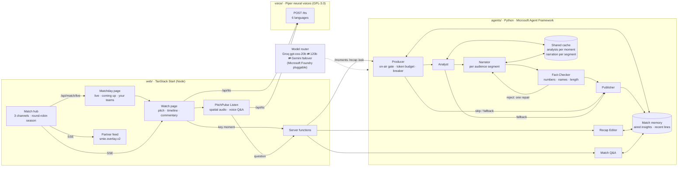

# PitchPulse: architecture

PitchPulse turns a live stream of synthetic, football-realistic events into explainable,
personalised match intelligence: on-screen overlays, live commentary, recaps, an audio
mode for blind and low-vision fans, and a machine-readable feed for broadcast partners.

All clubs, players and events are generated. No real league data is used.

Design rule: **numbers come from code, words come from agents.** Agents never invent
statistics. They select, explain and narrate facts the deterministic engine computed, and
a Fact-Checker verifies every line before it airs.

## The five-stage pipeline

| Stage           | What happens                                                                                                                                                          | Where                                                   |
| --------------- | --------------------------------------------------------------------------------------------------------------------------------------------------------------------- | ------------------------------------------------------- |
| **Ingest**      | A seeded simulator plays a six-club round-robin, three fixtures at once: passes, shots, tackles, possession and pressure events, with pitch coordinates and speeds.   | `web/src/match/engine.ts`, `web/src/match/hub.ts` (SSE) |
| **Interpret**   | Pure functions turn events into stats: xG, pass accuracy and difficulty, shot and run speed, pressing, control vs chaos, momentum, win probability, player tags.      | `web/src/match/engine.ts`                               |
| **Explain**     | A team of agents decides why a moment matters, citing evidence from the stats, and narrates it per audience.                                                          | `agents/` (Python, Microsoft Agent Framework)           |
| **Render**      | Tactical pitch, lower-third overlays, live commentary, timeline with replay, agent trace, and a versioned overlay feed (`smie.overlay.v2`).                           | `web/src/components/dashboard/`, `/api/public/feed`     |
| **Personalise** | Persona (analyst, casual fan, player focus, audio), six languages, favourite club and player, spoken commentary, and PitchPulse Listen for blind and low-vision fans. | Narrator agent, `web/src/listen/`, `voice/`             |

## System overview



## Agents

Each agent has one job and typed input and output (Pydantic models). They run as a
Microsoft Agent Framework **workflow**: executors connected by conditional edges, with the
Fact-Checker → Narrator edge as the repair loop. Every path, including every failure,
ends at the Publisher, so a moment always produces an overlay.

| Agent                  | Input                                                                 | Output                                                                | Why it is separate                                                                                             |
| ---------------------- | --------------------------------------------------------------------- | --------------------------------------------------------------------- | -------------------------------------------------------------------------------------------------------------- |
| **Producer**           | Moment, audience segments, token budget, circuit breaker              | Go / skip; deterministic mode when AI should not run                  | Owns on-air decisions and cost: AI only for moments that deserve it.                                           |
| **Analyst** (LLM)      | Event, facts table, recent insights from match memory                 | `Insight { category, claim, evidence[] }`, evidence cited by fact key | Reasons about football once per moment; every audience reuses it. Evidence is checked against the facts table. |
| **Narrator** (LLM)     | Insight, event (with `where` on the pitch), segment, its recent lines | Overlay text: at most 2 sentences, 220 characters                     | Writes from the insight, never from raw data. Commentator voice; varied openers.                               |
| **Fact-Checker**       | Draft narration, facts table, event                                   | Pass, or reject with reasons                                          | Every number must exist in the match data; the player must be named exactly; overlays must fit. One repair.    |
| **Publisher**          | Verified drafts or fallbacks                                          | `smie.overlay.v2` overlay with trace; updates memory and caches       | One place assembles provenance and falls back per segment.                                                     |
| **Recap Editor** (LLM) | Score, stats, aired insights, key moments                             | Headline + 3–4 narratives, fact-checked                               | Works over the whole match, not one moment.                                                                    |
| **Match Q&A** (LLM)    | A fan's spoken question, stats, player stats, recent events           | A 1–2 sentence spoken answer, fact-checked                            | Powers voice questions in PitchPulse Listen.                                                                   |

### Shared state

- **Match memory** (per match and restart): insights already aired, so the Analyst doesn't
  repeat itself, and the Narrator's recent lines, so its calls don't start the same way.
  The Recap Editor and Match Q&A read the same memory.
- **Shared cache**: the Analyst runs **once per moment** however many viewers are watching
  (single-flight: concurrent requests share one in-flight call), and verified narration
  is reused per audience segment. Failures are never cached.

### Failure recovery

1. The deterministic explanation is on screen **from the first frame**. AI upgrades it.
2. The whole workflow has a 4 s budget; on timeout the deterministic text stays on air.
3. **Fact-Checker rejects:** the Narrator gets the reasons and one retry; still wrong,
   that segment falls back. In the [evaluation](EVAL.md), all 28 injected hallucinations
   were caught and repaired.
4. **Rate limits:** each role has an ordered list of models. A rate-limited model rests
   for exactly as long as the provider asks, and the next one answers.
5. **Repeated model errors:** a circuit breaker switches to deterministic mode for 60 s.
6. **Token budget:** as the per-minute or per-day budget fills, AI is saved for big
   chances, then only goals, then none until it resets. The trace says why.

Every overlay carries its provenance:

```json
{
  "schema": "smie.overlay.v2",
  "match_id": "main",
  "moment_id": "1:57",
  "minute": 63,
  "headline": "63' Theo Quinn shot · xG 0.42",
  "insight": {
    "category": "chance_quality",
    "claim": "A high-value chance that shifts the expected story of the match.",
    "evidence": [{ "stat": "event.xg", "value": 0.42 }]
  },
  "narrations": [
    {
      "segment": { "persona": "casual", "language": "Swahili" },
      "text": "…",
      "verification": { "status": "repaired", "attempts": 2, "issues": [] }
    }
  ],
  "fallback": false,
  "trace": [
    { "agent": "producer", "ms": 0, "status": "ok", "note": "1 segment(s)" },
    { "agent": "analyst", "ms": 820, "status": "ok", "note": "chance_quality" },
    { "agent": "narrator", "ms": 610, "status": "ok", "note": "1 draft(s)" },
    { "agent": "fact_checker", "ms": 1, "status": "retry", "note": "rejected 1" },
    { "agent": "narrator", "ms": 540, "status": "retry", "note": "redrafted 1" },
    { "agent": "fact_checker", "ms": 1, "status": "ok", "note": "1/1 verified" }
  ]
}
```

## Personalisation at scale

One model call per viewer per moment does not scale to a broadcast audience.

- The Analyst runs once per moment, whatever the audience size.
- The Narrator runs once per audience **segment** (persona × language × favourite club and
  player), not per viewer, and the result is cached for everyone in that segment.
- Common spoken questions (score, time, where the ball is, how a player is doing) are
  answered on the device with no model call.
- Cost grows with the number of segments, not the number of viewers.

## PitchPulse Listen (accessibility)

A sheet in the dashboard that follows the live match through sound alone:

- **Spatial audio** (Web Audio, HRTF): the ball is a soft tick placed around the
  listener's head, faster near a goal; the favourite club always attacks to the right.
- **Earcons** for passes, shots, tackles and goals; rising or falling notes when
  possession changes, depending on which side wins it.
- **Commentary**: an instant spoken call, then verified AI narration in the `audio`
  persona, which says where on the pitch play is.
- **Voice questions** answered on the device or by the Match Q&A agent.
- Detail levels, speaking speed, and a screen-reader mode that hands speech to VoiceOver
  or TalkBack instead of talking over it.

Speech comes from the browser when it has a natural voice (Microsoft Edge), otherwise
from the voice service's Piper voices, so every browser can speak.

## Microsoft technology

| Technology                        | Role                                                                                                                                |
| --------------------------------- | ----------------------------------------------------------------------------------------------------------------------------------- |
| **Microsoft Agent Framework**     | Agents, the moment workflow (executors, conditional edges, repair loop), structured output.                                         |
| **Microsoft Foundry**             | Supported model backend (`FOUNDRY_PROJECT_ENDPOINT`). The demo runs on Groq's free tier because the team has no Azure subscription. |
| **Azure Container Apps** (target) | Each service ships as a container (`agents/Dockerfile`, `voice/Dockerfile`; the web app builds a Node server).                      |

## Data: synthetic and reproducible

- A six-club synthetic league plays a full round-robin (every club meets every other once)
  on three parallel channels. Channels kick off at staggered times; after full time and a
  short break, each moves on to its next fixture, so there is always something live and
  something coming up.
- Fans pick a match on the matchday page and choose clubs to follow; while watching, live
  matches of followed clubs stack in the corner of the pitch and goals there pop up.
- Every match is **seeded**: `?seed=N` replays it exactly, for demos, tests and the
  evaluation (`web/scripts/export-moments.ts` exports any match's key moments).
- Events carry pitch coordinates on a 105 × 68 m pitch, and shot quality follows distance
  and angle, so the tactical view, shot map and heatmap are consistent with the stats.
- Player portraits are generated once with FLUX.1-schnell (Apache-2.0) on Cloudflare
  Workers AI and cropped so no kit branding shows; club badges are DiceBear (CC0).

## Responsible AI

- Synthetic data only.
- No invented statistics: evidence is checked against the facts table and every aired
  number against the match data; every overlay shows its verification status.
- The deterministic fallback keeps the product working when AI is unavailable or the
  budget is spent.

## Out of scope

**Auto-eventing from video** is in the brief but needs real footage and a vision model. The
ingest stage is an interface, so a vision-based event source could replace the simulator
without changes downstream.
