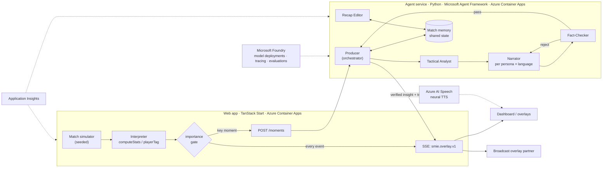

# PitchPulse — Architecture

PitchPulse is a Synthetic Match Insights Engine. It turns a live stream of synthetic, football-realistic events into explainable, personalised, on-screen match intelligence for studio, broadcast and streaming use.

All clubs, players and events are generated. No real Premier League data is used.

## The five-stage pipeline

| Stage           | What happens                                                                                                                                                                          | Where                                                            |
| --------------- | ------------------------------------------------------------------------------------------------------------------------------------------------------------------------------------- | ---------------------------------------------------------------- |
| **Ingest**      | A seeded match simulator emits passes, shots, tackles, possession changes, pressure events and metadata in match time.                                                                | `web/src/match/engine.ts`, served by the match session SSE route |
| **Interpret**   | Pure, deterministic functions aggregate events into stats: xG, pass accuracy and difficulty, ball and shot speed, pressure, control vs chaos, momentum, win probability, player tags. | `web/src/match/engine.ts`                                        |
| **Explain**     | A team of agents decides which moments matter and why, backed by evidence from the stats.                                                                                             | Agent service (Python, Microsoft Agent Framework)                |
| **Render**      | Each insight becomes a timed, machine-readable overlay (`smie.overlay.v1`) for the dashboard and for broadcast partners.                                                              | SSE feed + dashboard                                             |
| **Personalise** | The same verified insight is narrated per persona (analyst, casual fan, player focus), language, favourite club and favourite player. Optional Azure AI Speech voice.                 | Narrator agent + Azure AI Speech                                 |

Design rule: **numbers come from code, words come from agents.** Agents never invent statistics. They select, explain and narrate facts that the deterministic engine computed, and a checker verifies the result before it goes on air.

## System overview



## Agents

Each agent has one job and a typed input and output. They coordinate through a shared **match memory**, not through free-form chat.

| Agent                       | Input                                                    | Output                                                                                                                                    | Why it is separate                                                                                                                                                                    |
| --------------------------- | -------------------------------------------------------- | ----------------------------------------------------------------------------------------------------------------------------------------- | ------------------------------------------------------------------------------------------------------------------------------------------------------------------------------------- |
| **Producer** (orchestrator) | Candidate moment, stats, active viewer segments          | Go/no-go, priority, which persona × language segments to narrate, final overlay                                                           | Owns the live time budget and the fallback decisions.                                                                                                                                 |
| **Tactical Analyst**        | Event window, stats, match memory                        | `Insight { claim, category, evidence[] }`. Categories: control vs chaos, pressure shift, rhythm change, player milestone, chance quality. | Reasons about football once per moment. Every persona reuses that reasoning.                                                                                                          |
| **Narrator**                | `Insight` + persona, language, favourite club and player | Overlay text, at most 2 sentences                                                                                                         | Writes from the insight, never from raw data, so it cannot invent facts.                                                                                                              |
| **Fact-Checker**            | Narration + `Insight.evidence`                           | `pass`, or `reject` with the reasons                                                                                                      | Pulls every number and name out of the text and checks it against the evidence. An LLM judge also checks whether the claim follows from the evidence. One repair loop, then fallback. |
| **Recap Editor**            | Match memory: aired insights and milestones              | Half-time and full-time recaps, a headline plus key narratives, per persona and language                                                  | Works over the whole match, not one moment.                                                                                                                                           |

### Shared state: match memory

- Rolling event window and latest stats snapshot.
- Insights already aired, so the Analyst does not repeat "pressure is building" every minute.
- Narrative threads, for example "MER have pressed high since 30'". The Analyst can extend or close them, which gives the commentary continuity.
- Milestones already reached, such as distance thresholds, first goal, or the xG overtaking the scoreline.
- Active viewer segments (persona × language × favourite player), so we narrate only for segments someone is watching.

### Handoffs and failure recovery

Live overlays have a hard time budget, for example 2.5 s from event to AI text.

1. When a key moment arrives, the deterministic `explain()` text goes on screen **at once**. Viewers never wait for AI.
2. The Producer runs Analyst → Narrator → Fact-Checker inside the time budget.
3. **Fact-Checker rejects:** the Narrator gets the rejection reasons and one retry.
4. **Retry fails, agent times out, or model errors:** the Producer keeps the deterministic text and marks the overlay `fallback: true`.
5. **Repeated model errors:** a circuit breaker switches the match to deterministic mode for 60 s, then probes again.

Every overlay carries its provenance, so studios and judges can see what happened:

```json
{
  "schema": "smie.overlay.v2",
  "match_id": "main",
  "moment_id": "1:57",
  "minute": 63,
  "show": true,
  "duration_ms": 4500,
  "headline": "63' Theo Quinn shot · xG 0.42",
  "insight": {
    "category": "chance_quality",
    "claim": "A high-value chance that shifts the expected story of the match.",
    "evidence": [{ "stat": "event.xg", "value": 0.42 }]
  },
  "narrations": [
    {
      "segment": { "persona": "analyst", "language": "Spanish", "favourite_player": null },
      "text": "…",
      "verification": { "status": "repaired", "attempts": 2, "issues": [] }
    }
  ],
  "fallback": false,
  "trace": [
    { "agent": "producer", "ms": 0, "status": "ok", "note": "1 segment(s)" },
    { "agent": "analyst", "ms": 820, "status": "ok", "note": "chance_quality" },
    { "agent": "narrator", "ms": 610, "status": "ok", "note": "1 draft(s)" },
    { "agent": "fact_checker", "ms": 1, "status": "retry", "note": "rejected 1" },
    { "agent": "narrator", "ms": 540, "status": "retry", "note": "redrafted 1" },
    { "agent": "fact_checker", "ms": 1, "status": "ok", "note": "1/1 verified" }
  ]
}
```

## Personalisation at scale

The naive approach, one LLM call per viewer per moment, does not scale to a broadcast audience.

- The **Analyst runs once per moment**, whatever the audience size.
- The **Narrator runs once per active segment** (persona × language), not per viewer. Results are cached by `(momentId, persona, language, favouritePlayer?)`.
- Player-focus narration runs only when the viewer's favourite player is involved in the moment.
- The client applies favourite-club framing that needs no LLM (colours, ♥ badges, ordering).

Cost then grows with the number of segments, not the number of viewers.

## Microsoft and Azure services

| Service                                | Role                                                                                                                                                       |
| -------------------------------------- | ---------------------------------------------------------------------------------------------------------------------------------------------------------- |
| **Microsoft Foundry**                  | Hosts the model deployments used by every agent. Collects tracing and runs evaluations (groundedness of narration against evidence, fluency per language). |
| **Microsoft Agent Framework** (Python) | Defines the agents, the orchestration workflow, shared state and retry/fallback edges.                                                                     |
| **Azure Container Apps**               | Runs the web app and the agent service as two containers that scale independently.                                                                         |
| **Azure AI Speech**                    | Multi-language neural voice commentary, replacing the current TTS provider.                                                                                |
| **Application Insights**               | End-to-end traces from event to overlay, per-agent latency and fallback rate.                                                                              |

Stretch, only if the core is done: Azure Event Hubs between simulator and agent service, and Azure Managed Redis for match memory across replicas.

## Data: synthetic and reproducible

- The simulator is **seeded**. The same seed replays the same match, which makes demos, tests and evaluations repeatable.
- Fictional clubs and players, with realistic distributions for pass distance and difficulty, xG by zone, shot speed and run speed.
- Planned extensions: more event types (fouls, set pieces, substitutions), match scenario presets ("late comeback", "high-press derby"), and export of the generated dataset as JSON Lines for others to reuse.

## Responsible AI

- Synthetic data only. The UI and the feed both say so.
- No hallucinated statistics: narration is grounded in evidence and checked by the Fact-Checker, and every overlay has a verification status.
- Foundry content safety filters run on all model output.
- The deterministic fallback means the product keeps working even when AI is unavailable.

## Out of scope

**Auto-eventing from a video feed** is listed in the brief, but it needs real footage and a vision model. We do not build it. The ingest stage is an interface, so a vision-based event source could replace the simulator without changes downstream.
